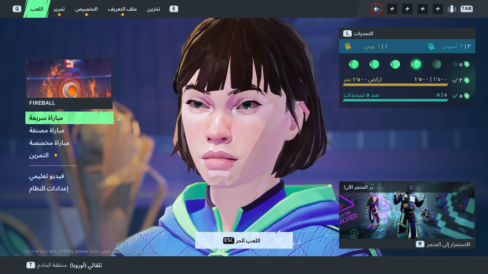

# مشروع تعريب لعبة Rematch الشامل ⚽🎮
### Rematch Arabic Localization (Full UI & Menus)

<div align="center">
  
</div>

مشروع تعريب احترافي وشامل للعبة كرة القدم **Rematch**، يشمل التعريب الكامل لكافة القوائم، الإعدادات، والنصوص وواجهات المستخدم (UI & Menus)، مع المعالجة الكاملة لاتجاه الحروف والكلمات العربية من اليمين لليسار (RTL Reshaping & BiDi Support) لتظهر النصوص بشكل طبيعي وسليم تماماً داخل محرك اللعبة Unreal Engine.

---

## 🌟 مميزات المشروع

- **تعريب شامل ودقيق لكافة القوائم (GameUI):**
  - ترجمة أكثر من **2,360 نصاً وسلسلة نصية** تغطي القوائم الرئيسية، قوائم الإعدادات (الصوت، الصورة، أسلوب اللعب، أزرار التحكم)، شاشات البطولات، التنبيهات، والشاشات الاجتماعية.
- **معالجة اتجاه النصوص العربية (BiDi & Reshaping):**
  - حل مشكلة الحروف المتقطعة والمعكوسة في محركات الألعاب عبر تشبيك الحروف وتطبيق خوارزمية الاتجاه ثنائي الاتجاه لضمان قراءة عربية سلسة ومريحة للعين.
- **تغطية شاملة لملفات التوطين:**
  - توفير ملفات التوطين الجاهزة بصيغة `.locres` المعيارية لمحرك Unreal Engine.
  - دعم اللغات والمسارات المعتمدة للواجهة (`ar`, `zh-Hans`, `zh-Hant`, `en`).
- **أدوات مفتوحة ومحدثة:**
  - توفير ملفات الاستيراد والتصدير بتنسيقات CSV و JSON لتسهيل المراجعة والتعديل المستقبلي مع أي تحديثات جديدة للعبة.

---

## 📁 هيكلية المشروع

```text
Rematch-Arabic-Localization/
├── GameUI_arabic.locres           # ملف الواجهة المعرب الجاهز (الصينية المبسطة zh-Hans)
├── GameUI_zh-Hant_arabic.locres   # ملف الواجهة المعرب الجاهز (الصينية التقليدية zh-Hant)
├── GameUI_ar.locres               # ملف الواجهة المعرب الجاهز للمسار العربي (ar)
├── GameUI_en.locres               # ملف الواجهة المعرب الجاهز للمسار الإنجليزي (en)
├── GameUI_zh-Hans_for_import.csv  # جدول النصوص والترجمات العربية (RTL) بصيغة CSV
├── GameUI_zh-Hant_for_import.csv  # جدول نصوص الصينية التقليدية مع الترجمة العربية
├── GameUI_en_for_import.csv       # جدول نصوص الإنجليزية مع الترجمة العربية
├── GameUI_zh-Hans_arabic_rtl.json # ملف الترجمة المعرب بصيغة JSON
├── patch_pak_root/                # بنية مجلدات التوطين المنظمة لمسارات المحرك
│   └── Runtime/Content/Localization/GameUI/
│       ├── ar/                    # مسار التوطين العربي
│       ├── en/                    # مسار التوطين الإنجليزي
│       ├── zh-Hans/               # مسار الصينية المبسطة
│       └── zh-Hant/               # مسار الصينية التقليدية
├── UnrealLocres.exe               # أداة فك وتجميع ملفات التوطين الثنائية .locres
├── repak.exe                      # أداة حزم وفك حزم حزم Unreal Engine Pak
└── oo2core_9_win64.dll            # مكتبة فك ضغط Oodle الخاصة بمحرك اللعبة
```

---

## 🛠️ البناء والتعديل من المصدر (For Developers)

إذا أردت تعديل أي نصوص أو إعادة تجميع ملفات `.locres` بنفسك:

### 1. استخراج وتعديل النصوص
يمكنك فتح أي من ملفات الـ CSV (مثل `GameUI_zh-Hans_for_import.csv`) وتعديل النصوص العربية في العمود الثالث (Target).

### 2. إعادة تجميع ملف `.locres`
باستخدام أداة `UnrealLocres.exe`:
```bash
.\UnrealLocres.exe import original_zh_GameUI.locres GameUI_zh-Hans_for_import.csv GameUI_arabic.locres
```

---

## 🙏 إسناد الفضل والتقدير (Credits & Acknowledgments)

- استوديو **Sloclap** على تطوير وتقديم لعبة كرة القدم الممتعة **Rematch**.
- **[UnrealLocres](https://github.com/akintos/UnrealLocres)** لمطوره *akintos* لمعالجة ملفات التوطين الثنائية لمحرك Unreal Engine.
- **[repak](https://github.com/trumank/repak)** لمطوره *trumank* للتعامل مع حزم وفهارس Unreal Engine.
- مكتبات **arabic-reshaper** و **python-bidi** لمعالجة وتشكيل النصوص العربية داخل محركات الألعاب.

---

## ⚖️ إخلاء مسؤولية (Disclaimer)

هذا التعريب عمل مجتمعي مستقل ومجاني بالكامل مخصص للاعبين الناطقين باللغة العربية، ولا يتبع أو يمثل شركة Sloclap أو الناشر بأي صفة رسمية. جميع العلامات وحقوق الملكية الفكرية تعود لأصحابها الأصليين.
